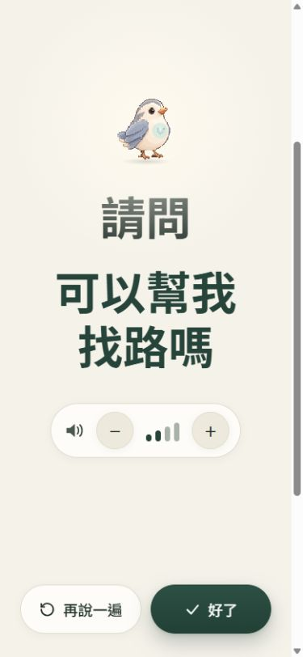

# PR #5：目的地確認與無目的地求助補修

交付日期：2026-10-23（台北）。對應 P3.5-R1、P3.5-R2，補上原本 475 項測試未涵蓋的介面操作。

本報告保留補修交付當時的紀錄；合併後重跑的三情境、最新截圖與 Mock 備援證據見 [PR④ 測試證據](../indoor-scenarios-2026-10-23/README.md)。

## 修正後的操作

| 情境 | 預期結果 | 回歸證據 |
|---|---|---|
| 先查藥局，再改成批價 | 改字就移除舊的「對／不是」；只能確認目前查詢的結果 | App 測試涵蓋改字、同字重送、改回原字、回覆順序顛倒與舊回覆不能關掉新等待狀態 |
| 拒絕目的地或重設時有較舊的請求未完成 | 舊回覆不能讓確認重新出現；重設同時清空輸入、答案、等待狀態 | App 測試涵蓋拒絕、重設已完成答案、重設等待中的請求 |
| 無法辨識、拒絕後、輸入中或等待中需要協助 | 按「幫我問」開通用求助，不啟動行程；等待中的舊回覆失效 | App 測試涵蓋 Mock／Nemotron 模式的 uncertain、拒絕、等待中求助與較晚回覆 |
| 還沒按「對」就長按鳥 | 不論答案未到或已到，都只開通用求助 | App 測試涵蓋 pending／answered 兩種情況 |
| 關閉通用求助 | 保留原輸入，焦點回輸入框，可改字重查 | App 測試涵蓋關閉、焦點、重查並確認藥局 |
| 已確認目的地／重設既有行程 | 行程中求助仍指向確認的目的地；重設後改回通用求助 | App 測試涵蓋藥局求助、掛號求助及重設 |
| 使用示範行程 | 僅輸入空白、沒有查詢／答案時出現次要的「開始示範行程」 | App 測試確認不會從 uncertain／拒絕直接誤入預設行程 |

通用求助只顯示與朗讀固定字串 `ask.generic`：「請問，可以幫我找路嗎？」。不帶目的地、不使用輸入原文、不建立行程或位置觀察。`renderAsk(null)` 有單元測試；語音清單與 PUBLIC 音量分類一併更新。已確認的地點仍使用原來的求助句。

## 截圖與瀏覽器驗證

下圖在 **2026-10-22 R2 完成後**以 Chrome、390×844 視窗擷取，2026-10-23 納入此次交付。瀏覽器為本機 Mock，沒有呼叫付費模型。手機寬度為桌面視窗模擬，並非手機實機。



當日已實測：uncertain → 求助 → 關閉保留輸入與焦點；拒絕 → 通用求助；重新查詢並確認藥局 → 藥局求助；重設 → 通用求助。桌面與手機寬度的文字、操作按鈕完整可見，console 無錯誤。TTS 內容與重播有自動測試，尚未實機試聽音質。

2026-10-23 交付時瀏覽器工具連續三次逾時，因此本次沿用上述已驗證截圖，沒有宣稱重新擷取或重新完成瀏覽器實測。延遲與競態的證據是可控制回覆順序的介面測試，靜態截圖不作為這些案例的證明。

原 [2026-10-22 Nemotron／Mock 截圖](../indoor-nemotron-2026-10-22/)保留為原始模型實測紀錄；其中 uncertain／API 失敗後的「開始」按鈕已被本次「幫我問」取代，不能用來判斷目前入口行為。

## 自動驗證（2026-10-23）

`src/ui/App.test.tsx` 有 20 個介面測試：真實 App、DestinationClient、hook 與 engine，在 React StrictMode 下以可控制完成順序的 fetch 回覆重現操作；不依賴外部 API 或付費模型。相較原 PR 的 475 項，新增 20 項 UI 與 2 項單元案例，共 **497 項、36 個檔案**。

```powershell
node node_modules/vitest/vitest.mjs run --maxWorkers=2 --minWorkers=1
node node_modules/typescript/bin/tsc --noEmit -p tsconfig.app.json
node node_modules/typescript/bin/tsc --noEmit -p tsconfig.node.json
node node_modules/typescript/bin/tsc -b
node node_modules/vite/bin/vite.js build
git diff --check
```

以上測試、型別檢查及 build 通過。直接使用本機 CLI 是為了避開本機 `npm.ps1` 讀取使用者設定的權限警告。

第一次以預設並行數跑測試、同時做型別檢查與 build 時，495 項通過，2 個 App 案例超過預設 5 秒時限（通用求助後重新查詢、朗讀與重播）；沒有斷言失敗。保持程式與測試時限不變，限制為 2 個 worker 後 **497/497 通過**。這項執行限制保留在紀錄中，沒有把第一次說成通過。

兩項補修各已經過獨立程式審查，沒有 Critical／Important；R2 審查建議的「已有辨識結果但未確認時長按」已補為回歸案例。這不取代維護者對 PR 的最後審查。

## 修改範圍

- 請求失效與入口：`src/ui/App.tsx`；無目的地選擇：`src/ui/useNightingale.ts`。
- 固定求助句：字串表、`src/render/renderer.ts`、字串清單及 canonical 語音計畫。
- `src/voice/level.ts` 僅將新增的 `ask.generic` 分類為 PUBLIC；沒有修改音量演算法或產生錄音。
- 測試依賴為開發用途：Testing Library、jsdom；Vite 測試搜尋納入 `.test.tsx`。
- 沒有修改 engine、registry、validator、戶外版或部署設定。辨識回覆仍只提供目的地，不作為已確認位置的證據；既有示範行程仍由大門起步。
