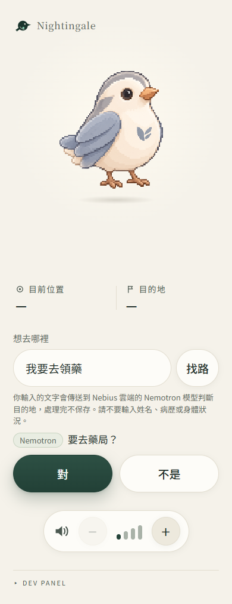
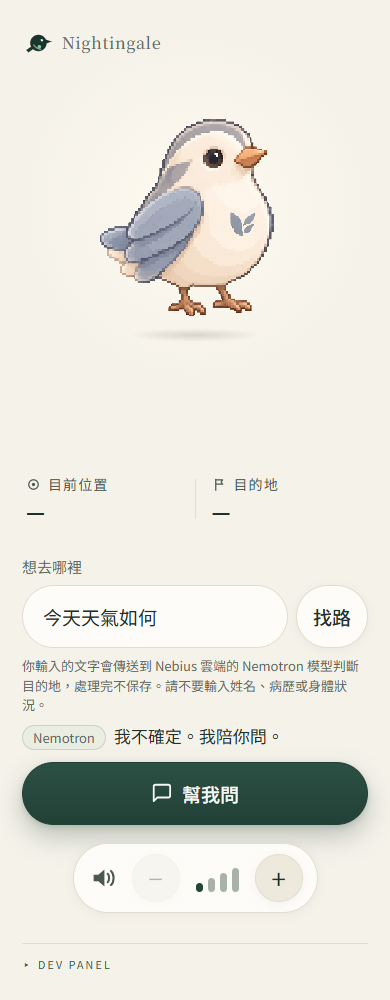
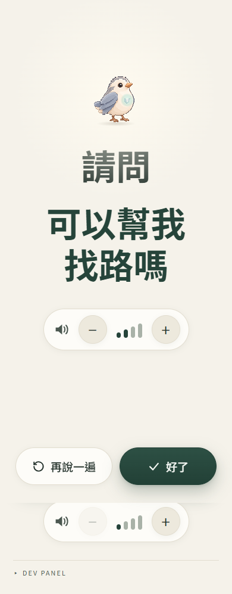

# Indoor destination scenarios — PR④ evidence

Recorded on **2026-10-23, Asia/Taipei**, against application revision
`70c40539396325e9b741eff421440af68d82f8cd` (merged PR #5, including R1/R2).
This delivery adds QA evidence and reproduction scripts; it changes no application behavior.

## Environment and evidence boundaries

- Local Vite UI: `http://127.0.0.1:5173/`; Hono proxy: `127.0.0.1:8787`.
- Headless Microsoft Edge `156.0.4314.42`, **390 × 844 CSS-pixel viewport**,
  fresh browser context for each case. Screenshots capture the full scrollable page,
  so their heights can exceed the viewport. These are desktop mobile-width tests,
  **not physical-phone, deployed-site or audio-quality acceptance**.
- The browser used the real UI, proxy, destination client and navigation engine.
  Responses and speech APIs were not mocked or intercepted. The failure test used
  a deliberately invalid credential, with a status-only observer around the real upstream fetch.
- Model: `nvidia/nemotron-3-super-120b-a12b`.
- Endpoint: `https://api.tokenfactory.nebius.com/v1/chat/completions`.
- All inputs below are synthetic test sentences. Real credentials stay in the
  server environment; no credential, authorization header or upstream response body is recorded here.

## Results

Times measure browser submission to receipt of the local proxy response; they are
single observations, not a latency benchmark. JSON timestamps are UTC (add eight hours for Taipei).

| Case | Setup and input | Actual result | Response time | Evidence |
| --- | --- | --- | --- | --- |
| Normal recognition | Real key; `我要去領藥` (I want to pick up medicine) | HTTP 200; `nemotron`, `PHARMACY`; confirmation required before starting pharmacy leg | 2,211 ms | [JSON](nemotron-result.json), [confirmation](01-normal-confirm.png), [navigation](01-normal-walk.png) |
| Unable to recognize | Real key; `今天天氣如何` (How is the weather today?) | HTTP 200; `nemotron`, `uncertain`; generic help available, no visit starts | 1,120 ms | [JSON](nemotron-result.json), [uncertain](02-unrecognized-uncertain.png), [help](02-unrecognized-help.png) |
| Upstream API failure | Deliberately invalid key; `我要去領藥` | Token Factory HTTP **401**; local proxy HTTP **200**, `nemotron`, `uncertain`; generic help available | 1,128 ms | [upstream status](api-failure-upstream.json), [browser JSON](api-failure-result.json), [uncertain](03-api-failure-uncertain.png), [help](03-api-failure-help.png) |
| Additional: proxy unavailable | Stop proxy; `我要去藥局` (I want to go to the pharmacy) | Vite HTTP **500**; browser falls back to Mock, visibly labeled `模擬`; confirmation starts pharmacy leg | 892 ms | [JSON](mock-result.json), [confirmation](04-mock-confirm.png), [navigation](04-mock-walk.png) |

All four cases passed the assertions in [check-browser.cjs](check-browser.cjs).
No JavaScript page errors occurred. Normal recognition, unrecognized input and
upstream API failure had no console errors. The stopped-proxy case produced one
expected HTTP 500 console error; that failed request triggered the labeled Mock fallback.

**The two failure paths differ:** a working proxy reporting a failed Nemotron call
returns `uncertain` without letting Mock guess instead. An unreachable proxy uses
the client-side Mock fallback and displays `模擬`.

## Steps and acceptance checks

Start each case in a fresh browser context, with no saved visit.

### 1. Normal recognition

1. Start the local proxy with the existing real key and open the UI.
2. Enter `我要去領藥` in `想去哪裡` (Where do you want to go?), then press `找路` (Find route).
3. Expect `Nemotron` and `要去藥局？` (Go to the pharmacy?), with `對` (Yes) and `不是` (No).
4. Verify no visit exists before confirmation and `開始示範行程` (Start demo visit) is absent.
5. Press `對`. Verify a visit starts on pharmacy leg index **2**, from node `ENTRANCE`.
   Recognition selects the destination; it does not claim the person is already at the pharmacy.



### 2. Unable to recognize

1. Keep the real-key proxy running; enter `今天天氣如何`, then press `找路`.
2. Expect `Nemotron` and `我不確定。我陪你問。` (I'm not sure. I'll help you ask.).
3. Verify no destination-confirmation button or demo-start button appears; input remains editable.
4. Press `幫我問` (Help me ask). Expect the generic dialog
   `請問，可以幫我找路嗎？` (Excuse me, could you help me find my way?).
5. Verify no visit starts. Press `好了` (Done); the original input is preserved and focus returns to it.



### 3. Upstream API failure

1. Stop the real-key proxy. In a separate terminal, start the same proxy with the
   deliberately invalid QA credential in its process environment. Leave `.env` unchanged.
2. Enter `我要去領藥`, then press `找路`.
3. Verify the status observer records upstream **401**, while the browser receives
   HTTP **200** with `{ "mode": "nemotron", "destination": { "kind": "uncertain" } }`.
4. Repeat the no-confirmation, generic-help, no-visit, input-preservation and focus checks from case 2.
5. Stop and close the invalid-key terminal before continuing.



### 4. Proxy unavailable / Mock fallback

1. Leave the proxy stopped and the Vite UI running.
2. Enter `我要去藥局`, then press `找路`.
3. Verify the proxy request fails with HTTP 500 and the UI visibly labels the answer `模擬` (Mock).
4. Verify `要去藥局？` appears without starting a visit; press `對` to start pharmacy leg index 2 from `ENTRANCE`.

## Reproducing this browser run

Use separate terminals for the UI, proxy and browser runner. The commands below
were used on Windows with Node `v26.12.1`. They are QA commands, not a deployment recipe.
The application dependencies must already be installed.

UI terminal (loopback only):

```powershell
node node_modules/vite/bin/vite.js --host 127.0.0.1 --port 5173 --strictPort
```

Real-key proxy terminal (`.env` supplies the existing key; never print its contents):

```powershell
node node_modules/vite-node/vite-node.mjs server/index.ts
```

Browser-runner terminal (Playwright Core is installed outside the repository):

```powershell
npm.cmd install --prefix "$env:TEMP/nightingale-qa-playwright" --no-audit --no-fund playwright-core
$env:PLAYWRIGHT_MODULE = "$env:TEMP/nightingale-qa-playwright/node_modules/playwright-core"
node docs/qa/indoor-scenarios-2026-10-23/check-browser.cjs nemotron
```

The runner uses installed Microsoft Edge. Set `EDGE_PATH` if its executable is elsewhere.
Each run replaces the corresponding JSON and screenshots; preserve this dated evidence before rerunning.
The `nemotron` mode makes two real model calls.

Stop the real-key proxy, then use a **separate disposable proxy terminal** for the failure case:

```powershell
$env:NEBIUS_API_KEY = 'qa-deliberately-invalid-credential'
node --require ./docs/qa/indoor-scenarios-2026-10-23/observe-upstream.cjs node_modules/vite-node/vite-node.mjs server/index.ts
```

In the browser-runner terminal:

```powershell
node docs/qa/indoor-scenarios-2026-10-23/check-browser.cjs api-failure
```

Stop and close the invalid-key terminal. With **no proxy** listening on 8787:

```powershell
node docs/qa/indoor-scenarios-2026-10-23/check-browser.cjs mock
```

The [status observer](observe-upstream.cjs) records only time and upstream HTTP status,
passing the original fetch response through unchanged. It is not loaded by normal application startup.
Close the UI terminal when finished. These runs do not modify `.env`.

## Automated regression evidence

Fresh run on the same revision: **497/497 tests passed, 36/36 files**, with two workers.
Command and full output: [test-output.txt](test-output.txt).

```powershell
node node_modules/vitest/vitest.mjs run --maxWorkers=2 --minWorkers=1
```

This includes destination parsing, Mock, Nemotron, proxy, client, renderer and the
20 App tests for stale replies, confirmation, rejection, reset and generic help.
Those tests use controlled inputs/network replies; the browser cases above provide
the separate real-provider evidence. Typecheck and build were not rerun for this
documentation-only step; final per-PR validation remains in delivery step 6.

## Run history and remaining limits

- Browser automation through the built-in browser tool timed out. The local Edge
  runner succeeded, using an external temporary Playwright installation.
- The [first browser attempt](first-attempt-locator-failure.json) received the correct
  `PHARMACY` result but failed to locate the confirmation: the selector required the
  entire paragraph to equal the question, although it also contains the `Nemotron` badge.
  Only the QA locator was corrected. The subsequent full run passed; application code did not change.
- Total real-key model calls in this session: **3** (one in the first attempt, two in
  the successful run). One additional request used the deliberately invalid credential.
- Current screenshots are newly captured after R1/R2. The
  [October 22 model screenshots](../indoor-nemotron-2026-10-22/README.md) remain historical:
  their old start-button behavior must not be treated as current. The
  [R1/R2 report](../indoor-review-2026-10-23/README.md) remains the original fix evidence.
- Browser latency/race conditions and timeout handling retain automated regression
  coverage; this session did not perform a new real-provider timeout experiment.
- English behavior, production deployment, physical-phone navigation, and audible
  TTS quality are not assessed here. Public deployment still requires abuse controls.
